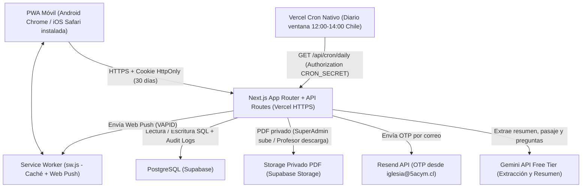

# Fase 2: Diseño de la App y Arquitectura

> **Versión:** 1.6 (Aprobada — Stack Opción B + Sistema Visual UX/UI ACyM + Ajustes QA Fases 4–5)  
> **Estado:** ✅ Cerrada y aprobada  
> **Basado en:** [01-analisis-y-requerimientos.md](./01-analisis-y-requerimientos.md) (`v1.5`)  
> **Objetivo:** Definir el stack tecnológico (costo `$0`), la arquitectura del sistema, el modelo físico de base de datos, los flujos técnicos críticos, el diseño de pantallas (*mobile-first*) y los endpoints de la API.

---

## 1. Propuesta de Stack Tecnológico (`$0 / mes` — Free Tier)

Para cumplir con **costo cero en tiendas y servidores**, simplicidad de mantenimiento y excelente soporte PWA + Web Push:

| Capa | Tecnología recomendada | Por qué conviene (Free Tier) | Alternativa viable |
| :--- | :--- | :--- | :--- |
| **Frontend (UI PWA)** | **Next.js (App Router) + React + TypeScript + Tailwind CSS** | Interfaz *mobile-first* rápida en Android e iOS, tipado estricto y estilos ligeros sin librerías pesadas. | React (Vite) separado (exige mantener 2 proyectos). |
| **Backend (API / Lógica)** | **Next.js Route Handlers (Node.js) + Drizzle ORM + Zod** | Vive dentro del mismo proyecto Next.js (`/api/...`), equivalente a tener un backend Express integrado, con validación estricta (Zod) y consultas SQL tipadas (Drizzle). | Backend separado (Express / NestJS / FastAPI). |
| **PWA y Web Push** | **`manifest.webmanifest` + Service Worker propio (`public/sw.js`) + librería `web-push` (VAPID)** | Control total del cacheo y notificaciones Push en Android e iOS sin depender de SDKs pesados ni Firebase pago. | `Serwist` / `@ducanh2912/next-pwa` (puede ser útil solo para caché, pero el `sw.js` propio es más predecible para Web Push). |
| **Hosting Web + Backend Serverless** | **Vercel (Plan Hobby — Gratis, sin tarjeta)** | Next.js ejecuta en el mismo despliegue tanto el frontend PWA como las rutas backend (`/api/...`) como funciones serverless con **Fluid Compute** y **Bytecode Caching**. Incluye HTTPS automático (obligatorio para PWA) y dominio personalizado gratis. | — |
| **Base de Datos** | **PostgreSQL en Supabase (Free Tier, sin tarjeta) + Drizzle ORM** | 500 MB gratis, PostgreSQL relacional completo y panel visual. Mientras esté activo no suspende la BD cada 5 min; se evita la pausa de 7 días con un ping diario ejecutado desde el propio Cron nativo de Vercel. | — |
| **Almacenamiento PDF privado** | **Supabase Storage (bucket privado)** | Integrado en el mismo proyecto Supabase (1 GB gratis), sin pedir tarjeta y accesible únicamente vía backend para Profesores de la clase y Super Admin. | — |
| **Procesamiento PDF + Generación Resumen/Preguntas** | **`unpdf` + Google Gemini API (Free Tier)** | Librería compatible con entorno Vercel Serverless para extraer texto sin assets en disco; Gemini Flash ofrece capa gratuita generosa vía Google AI Studio. | **Groq (Llama 3.3)** gratuito o carga manual asistida como respaldo. |
| **Envío de OTP por correo** | **Resend (3,000 correos/mes gratis) con dominio `5acym.cl`** | SDK oficial simple para Next.js, alta entregabilidad configurando DNS (`SPF`/`DKIM`) en `5acym.cl` para enviar desde `iglesia@5acym.cl` sin caer en Spam. | Gmail SMTP temporal solo en pruebas locales previas al dominio `.cl`. |
| **Scheduler diario (Keep-Alive + Push Lunes)** | **Vercel Cron Jobs nativo (`vercel.json`)** | Gratis dentro de Vercel Hobby (1 ejecución diaria con ventana operativa de 1 hora, sin servicios externos). Corre diariamente (`0 16 * * *` UTC = ventana `12:00–14:00` en `America/Santiago` considerando CLT UTC-4 y CLST UTC-3), mantiene viva la BD Supabase todos los días y los **lunes** envía el Web Push agrupado por padre. | — |

---

## 2. Arquitectura del Sistema

### Decisiones Arquitectónicas Clave
1. **Token único de 30 días en Cookie `HttpOnly` (sirve para la app y todas las peticiones HTTP):** No se utilizan dos tokens separados. Al validar el OTP, el servidor genera un único *Session Token* aleatorio de 30 días, guarda su hash en la tabla `sessions` y lo entrega en una cookie **`HttpOnly, Secure, SameSite=Lax`** (`__Host-ed_session` en HTTPS). El navegador envía esa cookie **automáticamente en cada petición HTTP** (`/api/...`) y el backend la valida contra PostgreSQL en cada solicitud. Ventajas: JavaScript no puede leer el token (protección XSS) y, si el Super Admin revoca la sesión o desactiva al usuario, el acceso se corta de inmediato.
2. **Desbloqueo `00:01` sin depender de cron:** En la BD se guarda `unlock_at` (timestamp UTC equivalente al lunes `00:01 America/Santiago`). El servidor evalúa si está desbloqueada considerando `schedule_status`: `FORCE_UNLOCKED` $\rightarrow$ desbloqueada; `PAUSED` o `FORCE_LOCKED` $\rightarrow$ bloqueada; `SCHEDULED` $\rightarrow$ `now() >= unlock_at`.
3. **Presencia en vivo inteligente a costo `$0`:** Mientras el usuario tiene la app visible (`document.visibilityState === 'visible'`), **únicamente cuando su estado es `ACTIVE`** (no durante `PENDING_ONBOARDING`) y registra interacción reciente, la PWA envía un pulso ligero (`POST /api/presence/ping`) cada ~60 segundos actualizando `users.last_seen_at`; tras **10 minutos de inactividad del usuario**, el cliente pausa los pulsos automáticamente para no mostrar falsos "En línea" ni consumir invocaciones inútiles. El panel del Super Admin refresca la lista cada ~15–20s mostrando 🟢 **En línea** si `now() - last_seen_at <= 90s`.
4. **PDF de hasta 25 MB y procesamiento IA sin *timeouts* ni límite de Vercel (4.5 MB):** Para respetar el tope de 4.5 MB por body de Vercel Hobby, la subida y descarga del PDF utilizan **Signed Upload/Download URLs** directas contra el bucket privado `unit-pdfs` de Supabase Storage (configurado en el bucket con `file_size_limit = 25 MB` y `allowed_mime_types = ['application/pdf']`). Luego, `POST /api/admin/units/:id/process-pdf` verifica primero los metadatos del objeto (`<= 25 MB`) antes de cargarlo en memoria, valida magic bytes `%PDF-`, extrae el texto y crea los 14 borradores (si el PDF es escaneado sin texto seleccionable, advierte al usuario y permite editar manualmente); finalmente el frontend genera con IA **lección por lección** (`1/14 ... 14/14`) con *throttle* (~4–5s entre llamadas, *backoff* ante HTTP `429`) y botón de **"Reintentar fallidas"**. El resumen para padres se guarda estructurado por párrafos limpios (sin Markdown crudo `**`).
5. **Auditoría transversal (`audit_logs`):** Todo endpoint de mutación relevante y lecturas sensibles (`LESSON_VIEW`, `PDF_DOWNLOAD`, `LOGIN_OTP`, `ATTENDANCE_SAVE`, etc.) invoca `recordAuditLog(...)` dentro de la operación. Los pulsos frecuentes de presencia (`POST /api/presence/ping`) **no** se auditan para mantener liviana la tabla.

---

## 3. Modelo Físico de Datos (PostgreSQL)

```mermaid
erDiagram
    users ||--o{ sessions : "tiene"
    users ||--o{ otp_codes : "solicita"
    users ||--o{ push_subscriptions : "registra"
    users ||--o{ class_teachers : "dicta"
    users ||--o{ parent_students : "es_tutor_de"
    users ||--o{ lesson_views : "abre"
    users ||--o{ lesson_completions : "marca_completada"
    users ||--o{ audit_logs : "ejecuta"

    classes ||--o{ class_teachers : "asignada_a"
    classes ||--o{ students : "contiene"
    classes ||--o{ units : "tiene"
    classes ||--o{ attendance_records : "registra"
    classes ||--o{ student_class_history : "historial"

    students ||--o{ parent_students : "vinculado_a"
    students ||--o{ student_class_history : "cambia_de_clase"
    students ||--o{ lesson_completions : "tiene_completada"
    students ||--o{ attendance_records : "asiste"

    units ||--o{ lessons : "contiene_14"

    lessons ||--o{ lesson_views : "registrada_en"
    lessons ||--o{ lesson_completions : "completada_en"

    users {
        uuid id PK
        varchar rut UK "Normalizado sin puntos con guion"
        varchar full_name
        varchar email UK "Unico por usuario"
        varchar phone "Opcional"
        varchar role "SUPER_ADMIN | TEACHER | PARENT"
        varchar status "PENDING_ONBOARDING | ACTIVE | INACTIVE"
        timestamptz onboarded_at
        timestamptz last_seen_at "Presencia en vivo"
        timestamptz created_at
    }

    otp_codes {
        uuid id PK
        uuid user_id FK
        varchar code_hash "HMAC-SHA256 del OTP con pepper"
        timestamptz expires_at "Ej. +10 min"
        timestamptz used_at
        int attempts
        timestamptz created_at
    }

    rate_limits {
        varchar key PK "ip_hash o rut_hash + ventana"
        int count
        timestamptz reset_at
    }

    sessions {
        uuid id PK
        uuid user_id FK
        varchar token_hash UK
        timestamptz expires_at "+30 días"
        timestamptz revoked_at
        varchar user_agent
        timestamptz created_at
    }

    push_subscriptions {
        uuid id PK
        uuid user_id FK
        text endpoint UK
        text p256dh
        text auth
        varchar platform "android | ios | desktop"
        timestamptz created_at
    }

    classes {
        uuid id PK
        varchar name
        varchar age_range
        varchar status "ACTIVE | ARCHIVED"
        timestamptz created_at
    }

    class_teachers {
        uuid class_id PK,FK
        uuid teacher_id PK,FK
    }

    students {
        uuid id PK
        uuid class_id FK "Clase actual"
        varchar full_name
        date birth_date "Opcional"
        text special_care "Alergias/cuidados internos"
        jsonb preferences "Ej. dibujar, pintar, cantar, escribir"
        text preferences_notes "Detalle opcional interno"
        varchar status "ACTIVE | INACTIVE"
        timestamptz created_at
    }

    student_class_history {
        uuid id PK
        uuid student_id FK
        uuid class_id FK
        timestamptz assigned_at "Se crea desde el alta inicial y en traslados"
        timestamptz unassigned_at "NULL mientras este activo en esa clase"
    }

    parent_students {
        uuid parent_id PK,FK
        uuid student_id PK,FK
        varchar relationship "Opcional: Mama/Papa/Tutor"
    }

    units {
        uuid id PK
        uuid class_id FK
        int order_number
        varchar title
        text pdf_storage_key "Privado: Profesor/SuperAdmin; nullable en DRAFT"
        varchar status "DRAFT | ACTIVE | FINISHED"
        timestamptz created_at
    }

    lessons {
        uuid id PK
        uuid unit_id FK
        int lesson_number "1..14"
        varchar title "Nullable en DRAFT"
        varchar bible_passage "Nullable en DRAFT"
        jsonb parent_summary "Array de parrafos limpios sin Markdown; nullable en DRAFT"
        jsonb reinforcement_questions "Array de 2-3+ strings; nullable en DRAFT"
        date class_sunday_date "Domingo de clase; nullable en DRAFT"
        timestamptz unlock_at "Lunes 00:01 America/Santiago en UTC; nullable en DRAFT"
        varchar schedule_status "SCHEDULED | PAUSED | FORCE_UNLOCKED | FORCE_LOCKED"
        boolean push_sent "Evita reenvio el lunes"
    }

    lesson_views {
        uuid id PK
        uuid lesson_id FK
        uuid parent_id FK
        timestamptz first_viewed_at
        timestamptz last_viewed_at
    }

    lesson_completions {
        uuid id PK
        uuid lesson_id FK
        uuid student_id FK
        uuid completed_by_user_id FK
        timestamptz completed_at
    }

    attendance_records {
        uuid id PK
        uuid class_id FK
        uuid student_id FK
        date attendance_date "Domingo <= hoy"
        boolean is_present
        text observation "Opcional"
        uuid recorded_by_user_id FK
        timestamptz created_at "Ancla ventana 3d via MIN(created_at) por clase/domingo"
        timestamptz updated_at
    }

    audit_logs {
        uuid id PK
        uuid actor_user_id FK
        varchar actor_role
        varchar action "LOGIN_OTP | ATTENDANCE_SAVE | PDF_DOWNLOAD | etc."
        varchar entity_type
        varchar entity_id
        jsonb details "Resumen antes/despues"
        timestamptz created_at
    }
```

### Restricciones e Índices Clave
- `units`: índice único parcial `(class_id) WHERE status = 'ACTIVE'` $\rightarrow$ como máximo **1 unidad `ACTIVE`** por clase a la vez (puede coexistir con borradores `DRAFT` o historial `FINISHED`).
- `lesson_views`: índice único `(lesson_id, parent_id)` $\rightarrow$ 1 registro de "Visto" por padre y lección.
- `lesson_completions`: índice único `(lesson_id, student_id)` $\rightarrow$ 1 estado "Completado" por alumno y lección (compartido entre ambos padres).
- `attendance_records`: índice único `(class_id, student_id, attendance_date)`.
- `student_class_history`: índice `(student_id, unassigned_at)` y `(class_id, assigned_at)`.
- `lessons`: índice único `(unit_id, lesson_number)`.
- `audit_logs`: índice en `(created_at DESC)`, `(actor_user_id)` y `(action)` para búsquedas rápidas del Super Admin; tabla **append-only** (sin endpoints de `UPDATE` ni `DELETE`).

---

## 4. Diseño Técnico de Flujos Críticos

### 4.1. Acceso por RUT + OTP + Onboarding + Token 30 días
1. Usuario abre la PWA $\rightarrow$ `GET /api/auth/me` valida la cookie en `sessions`; si no hay sesión válida, ve pantalla **Ingreso**.
2. Ingresa **RUT** (formateo automático `12.345.678-5`, validado con `@fdograph/rut-utilities` módulo 11).
3. `POST /api/auth/request-otp`:
   - Si el RUT existe y está `PENDING_ONBOARDING` o `ACTIVE` (respetando cooldown por `rut_hash` e IP en `rate_limits`), genera OTP de 6 dígitos, guarda su `HMAC-SHA256` en `otp_codes` (expira en 10 min, invalidando códigos previos no usados) y envía correo con `waitUntil` (usando fallback local compatible con `next dev` y captura de errores en logs) y respuesta neutra para evitar enumeración y ataques de tiempo.
4. `POST /api/auth/verify-otp`:
   - Verifica atómicamente hash, expiración, `used_at IS NULL`, `attempts < 5` y que el usuario siga en `PENDING_ONBOARDING` o `ACTIVE`.
   - Crea sesión de **30 días** en `sessions`, emite cookie `HttpOnly, Secure, SameSite=Lax` (`__Host-ed_session` en HTTPS), actualiza `last_seen_at` y registra `LOGIN_OTP` en `audit_logs`.
5. Si `status == 'PENDING_ONBOARDING'`:
   - Wizard de 3 pasos: (1) confirmación de datos/vínculos, (2) guía instalación PWA Android/iOS Safari, (3) activar Web Push (`POST /api/push/subscribe` con `UPSERT` por `endpoint`) $\rightarrow$ en iOS Safari fuera de modo *standalone*, detecta falta de `PushManager`/`Notification`, muestra aviso para instalar primero y permite finalizar sin error (`ACTIVE` + `ONBOARDING_COMPLETED`).
6. Al cerrar sesión (`POST /api/auth/logout`), se revoca la sesión en BD, se limpia la cookie y el cliente desvincula la suscripción Push de ese navegador (`DELETE /api/push/subscribe`).

### 4.2. Carga del PDF Único (hasta 25 MB), Generación IA y Descarga Segura
1. **Subida directa mediante Signed URL (`POST /api/admin/units/upload-url`):** Para respetar el límite de 4.5 MB de Vercel Hobby, el bucket privado `unit-pdfs` en Supabase Storage se configura con **`file_size_limit = 26214400` (`25 MB`)** y **`allowed_mime_types = ['application/pdf']`**. Al solicitar subida (creando unidad `DRAFT` con `pdf_storage_key = NULL` inicialmente, o reemplazo sobre un `DRAFT` existente), el servidor genera una nueva ruta única (`units/<classId>/<uuid>.pdf`) y retorna la **Signed Upload URL** **sin sobrescribir ni borrar todavía el `pdf_storage_key` anterior** si se trata de un reemplazo.
2. **Extracción y generación (`POST /api/admin/units/:id/process-pdf` + `POST /api/admin/lessons/:id/generate`):** El cliente sube el archivo directo a Storage y envía el `storageKey` a `process-pdf`. El servidor consulta primero los metadatos del objeto en Storage para confirmar tamaño `<= 25 MB` antes de leerlo en memoria, valida magic bytes `%PDF-`, extrae el texto y crea/actualiza los 14 borradores (si detecta PDF escaneado con texto vacío, notifica y habilita edición manual). **Solo tras validar y asignar `units.pdf_storage_key`** al nuevo archivo, elimina el `pdf_storage_key` previo en Storage si existía. Luego el panel ejecuta la generación IA lección por lección (`1/14 ... 14/14`) con pausa entre llamadas (~4–5s, backoff exponencial ante `429`) y botón **"Reintentar fallidas"**. El resumen se estructura como lista de párrafos limpios sin Markdown crudo (`**`).
3. **Publicación y limpieza:** `PATCH /api/admin/units/:id` al pasar a `ACTIVE` verifica que la clase no tenga otra unidad activa, exige `units.pdf_storage_key NOT NULL`, valida que las 14 lecciones tengan completos `title`, `bible_passage`, `parent_summary`, `reinforcement_questions`, `class_sunday_date` y `unlock_at`, y marca `push_sent = true` en lecciones pasadas ya desbloqueadas para evitar envíos retroactivos. Si se elimina un `DRAFT`, se elimina su archivo asociado en Storage si existiera.
4. **Descarga para Profesores (`GET /api/teacher/units/:id/pdf`):**
   - Verifica rol `SUPER_ADMIN` o `TEACHER` asignado a la `class_id` de esa unidad, **y que `units.status IN ('ACTIVE', 'FINISHED')`** (nunca `DRAFT`; si es `PARENT`, responde `403 Forbidden`).
   - Genera una **Signed Download URL** efímera de Supabase Storage con **`{ download: true }`** (60s, forzando `Content-Disposition: attachment` para que iOS PWA *standalone* no quede atrapado en visor externo y evitando streaming pesado en Vercel) y registra `PDF_DOWNLOAD` en `audit_logs`.

### 4.3. Asistencia Dominical con Ventana de 3 Días desde Creación (Profesor) vs Ilimitada (Super Admin)
- En `PUT /api/teacher/attendance`:
  - Verifica que `attendance_date` corresponda estrictamente a **domingo** y sea `<= hoy` en `America/Santiago`, y que cada `student_id` pertenezca a `class_id` actual (`students.class_id = :classId`) **o** haya pertenecido a `class_id` en esa fecha según `student_class_history` (o ya figure en `attendance_records` de ese domingo), de modo que un traslado entre clases dentro de los 3 días no bloquee al profesor anterior al corregir la lista dominical.
  - Consulta **`MIN(created_at)` en `attendance_records` para esa `(class_id, attendance_date)`**:
    - Si aún **no existe ningún registro** para esa clase y fecha dominical (incluso si se olvidó tomar el domingo y se crea días después), permite crear la lista y fija `created_at = now()`.
    - Si **ya existe al menos un registro** para `(class_id, attendance_date)` y el actor es `TEACHER`: calcula las fechas calendario (`YYYY-MM-DD`) en `America/Santiago` y valida que `hoy_chile <= fecha_primera_creacion_chile + 3 días`. Si excede los 3 días calendario desde esa creación inicial, retorna `403` (*"Plazo de 3 días tras la creación vencido; solicita corrección al Super Admin"*), bloqueando tanto modificaciones como inserciones tardías de alumnos nuevos para esa fecha.
    - Si el actor es `SUPER_ADMIN`: omite la restricción de 3 días (puede modificar o agregar alumnos omitidos en cualquier fecha) y registra `ATTENDANCE_ADMIN_OVERRIDE` (o `ATTENDANCE_SAVE`) en `audit_logs`.

### 4.4. Reprogramación Segura por DST, Keep-Alive/Limpieza y Web Push (Lunes 12:00–14:00)
- **Pausar/Correr (`+7 días` en `postpone`) y Revertir (`-7 días` en `unpostpone`):** Acepta parámetro opcional `fromLessonNumber` seleccionado por el Super Admin (por defecto, la primera lección `SCHEDULED` con `unlock_at >= inicio_lunes_actual_chile` y `push_sent = false`, o la siguiente lección futura `SCHEDULED`). Desplaza primero `class_sunday_date` en ±7 días calendario sobre todas las lecciones `SCHEDULED` con `lesson_number >= fromLessonNumber` y **recalcula `unlock_at` desde `class_sunday_date + 1 día` a las `00:01` en `America/Santiago` $\rightarrow$ UTC** (evitando desfases de 1 hora en cambios de horario CLT/CLST). En `unpostpone` (`-7 días`), valida dentro de la transacción: si `fromLessonNumber > 1`, que la nueva `class_sunday_date` resultante sea **estrictamente mayor (`>`) que la de `fromLessonNumber - 1`**; y si `fromLessonNumber === 1`, que **`nueva class_sunday_date >= domingo_semana_en_curso`** en `America/Santiago` (permite revertir una pausa hecha el lunes por la mañana hacia el domingo recién pasado, pero impide retroceder hacia semanas ya cerradas), respondiendo `409 Conflict` ante exceso o doble clic. Registra `UNIT_POSTPONE` o `UNIT_UNPOSTPONE` en `audit_logs`.
- **Cron diario unificado (`GET /api/cron/daily` vía Vercel Cron):** Configurado en `vercel.json` (`0 16 * * *` UTC, ventana de ejecución diaria en `12:00–14:00` hrs Chile).
  1. Todos los días ejecuta `SELECT 1` para mantener activa la BD Supabase y **limpia registros expirados** (`otp_codes`, `rate_limits` y `sessions` vencidas).
  2. Si hoy es **lunes** en `America/Santiago`: busca lecciones de unidades `ACTIVE` con **`unlock_at >= inicio_lunes_00_00_chile AND unlock_at <= now()`**, `push_sent = false` y `schedule_status NOT IN ('PAUSED', 'FORCE_LOCKED')`. Cruza `class_id` $\rightarrow$ alumnos `ACTIVE` $\rightarrow$ padres `ACTIVE` con `push_subscriptions` y agrupa por `user_id` para enviar **máximo 1 notificación por padre**. Tras el envío, marca `push_sent = true` (si una suscripción responde `410 Gone`, la elimina).

### 4.5. Fórmulas Explícitas de KPIs (`/api/teacher/kpis`, `/api/admin/kpis`)
- **KPI Asistencia:** `(total registros con is_present = true en domingos registrados) / (total alumnos evaluados en esos domingos) * 100`.
- **KPI Apertura (Visto):** `(pares (lección desbloqueada de unidad ACTIVE, padre ACTIVE vinculado a esa clase) con registro en lesson_views) / (total pares esperados) * 100`.
- **KPI Refuerzo en Casa (Completado):** `(pares (lección desbloqueada de unidad ACTIVE, alumno ACTIVE de la clase con >=1 padre vinculado) con registro en lesson_completions) / (total pares esperados) * 100`.

---

## 5. Diseño UI/UX y Mapa de Pantallas (*Mobile-First*)

### 5.1. Guía Visual y Sistema de Diseño (Identidad ACyM — Naranjo y Blanco)

Pensada para lectura cómoda en familia, uso rápido con una mano en el celular y contraste alto bajo luz natural (sin saturar la vista):

| Token / Elemento | Valor recomendado | Uso en la interfaz |
| :--- | :--- | :--- |
| **Color Primario (Naranjo ACyM)** | `#EA580C` *(hover `#C2410C`)* | Botones principales (*"Ingresar"*, *"Marcar como completada"*, *"Guardar Asistencia"*), barra superior/acentos, ícono PWA y pestaña activa. |
| **Tinte Naranjo Suave** | `#FFF7ED` *(borde `#FED7AA`, texto `#9A3412`)* | Tarjeta del **Pasaje Bíblico Base**, badge *"Nueva lección"* y destacados cálidos. |
| **Fondo Principal (Blanco Cálido)** | `#FAFAF9` *(superficie tarjetas `#FFFFFF`)* | Fondo general limpio que evita el brillo agresivo del blanco puro `#FFFFFF` continuo y mantiene la identidad **naranjo + blanco**. |
| **Bordes y Divisores** | `#E7E5E4` | Separación sutil entre tarjetas de lecciones, acordeones y filas de asistencia. |
| **Texto Principal / Secundario** | `#1C1917` / `#57534E` | Máxima legibilidad en celular para resúmenes y preguntas bíblicas. |
| **Estados Semánticos** | Verde `#16A34A` (fondo `#F0FDF4`) / Gris `#78716C` (fondo `#F5F5F4`) / Rojo suave `#DC2626` (fondo `#FEF2F2`) / Ámbar `#D97706` | **Verde:** Lección completada, alumno Presente, usuario 🟢 En línea. **Gris:** Lección bloqueada con candado. **Rojo:** Toggle Ausente o acción destructiva (desactivar/revocar). **Ámbar:** Pendiente de onboarding o ventana de 3 días por vencer. |
| **Tipografía** | **`Plus Jakarta Sans`** *(o `Inter`)* vía `next/font/google` | Moderna, cálida y muy legible en pantallas pequeñas; números de RUT, fechas y KPIs con `tabular-nums`. |
| **Ergonomía Táctil** | Altura mínima de botones/toggles `44px–48px` (`min-h-11`), bordes redondeados `12px` (`rounded-xl`) | Evita clics erróneos al marcar asistencia en sala o al confirmar una lección en el celular. |
| **Identidad / Ícono PWA** | Fondo `#EA580C` con símbolo blanco `#FFFFFF` | Ícono limpio en Android e iOS (ej. Biblia abierta + semilla/cruz minimalista) y barra superior con título *"Escuela Dominical 5ta ACyM"*. |

**Reglas visuales de tarjetas de lección (Vista Padre):**
- **Desbloqueada (pendiente):** Fondo blanco `#FFFFFF`, franja lateral izquierda naranjo `#EA580C`, badge *"Disponible"* y flecha para abrir.
- **Completada:** Fondo `#F0FDF4` muy sutil o borde verde, check `✅` y texto *"Completada por [Nombre]"*.
- **Bloqueada:** Fondo gris suave `#F5F5F4`, opacidad reducida, ícono candado 🔒 y fecha estimada (*"Se desbloquea el lunes DD/MM"*), no clickeable.

### 5.2. Mapa de Pantallas por Rol (Navegación Inferior Fija)

### A. Vista Padre / Madre / Tutor
1. **Inicio / Lecciones (`/`):**
   - Selector por clase/hijo (si tuviera >1 clase).
   - Acordeón de Unidades (`> Unidad 1` colapsada, `v Unidad 2` activa desplegada con lecciones desbloqueadas, completadas y bloqueadas con candado).
2. **Detalle de Lección (`/lecciones/:id`):**
   - Registra **Visto** automáticamente al abrir.
   - Muestra Título + **Pasaje Bíblico Base** + **Resumen** (párrafos limpios) + **Preguntas de refuerzo**.
   - Botón **"Marcar como completada"** $\rightarrow$ **Modal de confirmación** con checklist de hijo(s) de esa clase (todos preseleccionados por defecto si hay >1) $\rightarrow$ estado `"✅ Completada (por [Nombre])"` compartido con el otro padre + opción **"Desmarcar"** con confirmación por alumno.
3. **Mi Perfil (`/perfil`):** Datos básicos, hijos vinculados, activar Web Push, guía de instalación PWA y cerrar sesión.

### B. Vista Profesor (Admin de Clase)
1. **Asistencia (`/profesor/asistencia`):**
   - Selector de clase y domingo. Lista limpia solo con nombres + toggle **Presente / Ausente** + observación opcional.
   - Indicador visual cuando una fecha superó los **3 días** (*"Solo lectura — plazo de 3 días finalizado"*).
   - Pestaña/acceso a **Historial de asistencia**.
2. **Alumnos (`/profesor/alumnos`):**
   - Lista de alumnos de la clase $\rightarrow$ al tocar un niño abre su **Ficha Interna** (edad, cuidados/alergias y preferencias como *dibujar, pintar, cantar, escribir*).
3. **Lecciones y Seguimiento (`/profesor/lecciones`):**
   - Ve las **14 lecciones sin bloqueo** + botón **"Descargar PDF de la Unidad"**.
   - Sub-pestañas por lección: **Contenido** y **Seguimiento Padres** (KPIs + lista de `Completado` por niño y `Visto` por padre).
4. **KPIs (`/profesor/resumen`):** Métricas limpias de asistencia, apertura y completado.

### C. Vista Super Admin
*(Hereda todas las pantallas de Profesor — sin bloqueo de 3 días en asistencia — más el módulo **Gestión**)*
1. **Gestión de Clases (`/admin/clases`):** Crear/archivar clases y asignar profesores.
2. **Usuarios y Enrolamiento (`/admin/usuarios`):**
   - CRUD de Profesores y Padres + botón revocar sesiones.
   - Columnas/badges en vivo: Estado onboarding (`Pendiente` / `Activo` / `Inactivo`) + Presencia (🟢 `En línea` / `Última vez hace...`).
3. **Niños / Ficha Interna (`/admin/alumnos`):** CRUD de alumnos, vínculo N:M con padres/tutores, cuidados especiales/alergias y preferencias de aprendizaje.
4. **Unidades y PDF (`/admin/unidades`):** Crear unidad vía Signed Upload URL, extracción de texto + progreso IA `1/14..14/14` con botón **"Reintentar fallidas"**, editor de pasaje/resumen/preguntas, botones **"Pausar / Correr +7 días"** y **"Revertir -7 días"**, bloqueo/desbloqueo manual y publicar/finalizar unidad.
5. **Auditoría / Logs (`/admin/logs`):** Visor cronológico de todos los movimientos del sistema con filtros por usuario, acción y rango de fechas.

---

## 6. Contratos de API (Endpoints Principales)

| Módulo | Método y Ruta | Acceso | Descripción |
| :--- | :--- | :--- | :--- |
| **Auth & Presencia** | `GET /api/auth/me` | Autenticado | Retorna perfil, rol, estado onboarding e hijos vinculados. |
| | `POST /api/auth/request-otp` | Público | Valida RUT y envía OTP por email. |
| | `POST /api/auth/verify-otp` | Público | Verifica OTP atómicamente, emite cookie 30 días y audita login. |
| | `POST /api/auth/onboarding` | Autenticado | Completa onboarding y marca `ACTIVE`. |
| | `POST /api/auth/logout` | Autenticado | Revoca sesión, limpia cookie y desvincula Push del dispositivo. |
| | `POST /api/presence/ping` | Autenticado | Actualiza `last_seen_at` (~cada 60s; se pausa tras 10 min inactivo; sin audit log). |
| **Push** | `POST /api/push/subscribe` | Autenticado | Registra/actualiza suscripción Web Push (`UPSERT` por `endpoint`). |
| | `DELETE /api/push/subscribe` | Autenticado | Elimina suscripción Push del navegador actual. |
| **Padres** | `GET /api/parent/units` | Padre | Lista unidades activas e históricas del alumno (oculta contenido bloqueado). |
| | `GET /api/parent/lessons/:id` | Padre | Detalle de lección desbloqueada + registra **Visto** + audita. |
| | `POST /api/parent/lessons/:id/complete` | Padre | Marca completado para `studentIds[]` en lección desbloqueada (`ACTIVE`/`FINISHED`) + audita. |
| | `POST /api/parent/lessons/:id/uncomplete` | Padre | Desmarca completado para `studentIds[]` en lección desbloqueada (`ACTIVE`/`FINISHED`, conserva Visto) + audita. |
| **Profesor** | `GET /api/teacher/classes` | Prof / SuperAdmin | Clases asignadas y alumnos activos. |
| | `GET /api/teacher/units` | Prof / SuperAdmin | Lista unidades `ACTIVE` y `FINISHED` de sus clases asignadas con sus 14 lecciones (excluye `DRAFT`). |
| | `GET /api/teacher/students/:id` | Prof / SuperAdmin | Ficha interna del niño (cuidados y preferencias). |
| | `GET /api/teacher/units/:id/pdf` | Prof / SuperAdmin | Genera Signed Download URL (60s, `{ download: true }`) del PDF de unidad `ACTIVE`/`FINISHED` + audita. |
| | `GET /api/teacher/attendance` | Prof / SuperAdmin | Obtiene asistencia e historial por fecha dominical/clase/alumno. |
| | `PUT /api/teacher/attendance` | Prof (<=3d desde `MIN(created_at)`) / SuperAdmin | Crea/edita asistencia de domingo (`<= hoy`, validando clase actual o `student_class_history`) + observación + audita. |
| | `GET /api/teacher/lessons/:id/tracking` | Prof / SuperAdmin | Detalle de lección de unidad `ACTIVE`/`FINISHED` (sin bloqueo semanal) + KPIs Visto/Completado. |
| | `GET /api/teacher/kpis` | Prof / SuperAdmin | Métricas de asistencia, apertura y refuerzo en casa de sus clases. |
| **Super Admin** | `CRUD /api/admin/users` | SuperAdmin | Gestión usuarios, presencia en vivo y revocación + audita. |
| | `CRUD /api/admin/students` | SuperAdmin | Gestión niños (alta inicial + traslados en `student_class_history`), cuidados/preferencias y vínculos + audita. |
| | `CRUD /api/admin/classes` | SuperAdmin | Gestión de clases y profesores + audita. |
| | `GET /api/admin/units` | SuperAdmin | Lista unidades (`DRAFT`, `ACTIVE`, `FINISHED`) por clase y estado de sus 14 lecciones. |
| | `POST /api/admin/units/upload-url` | SuperAdmin | Emite Signed Upload URL privada (`bucket <=25 MB`) y crea `DRAFT` (`pdf_storage_key` nullable hasta confirmar) o nueva ruta de reemplazo. |
| | `POST /api/admin/units/:id/process-pdf` | SuperAdmin | Verifica metadatos (`<= 25 MB`) y `%PDF-`, genera 14 borradores, asigna/intercambia `pdf_storage_key` y limpia PDF anterior + audita. |
| | `GET/PATCH/DELETE /api/admin/units/:id` | SuperAdmin | Consulta, activa/finaliza o elimina borrador (limpiando PDF en Storage) + audita. |
| | `POST /api/admin/lessons/:id/generate` | SuperAdmin | Genera con IA pasaje, resumen en párrafos y preguntas por lección. |
| | `PATCH /api/admin/lessons/:id` | SuperAdmin | Edita contenido o estado manual (`FORCE_UNLOCKED`/`FORCE_LOCKED`) + audita. |
| | `POST /api/admin/units/:id/postpone` | SuperAdmin | Pausa/corre `+7 días` desde `fromLessonNumber` (o lunes AM antes de Push) recalculando DST + audita. |
| | `POST /api/admin/units/:id/unpostpone` | SuperAdmin | Revierte `-7 días` desde `fromLessonNumber` validando cota mínima / no traslape (`409`) + audita. |
| | `GET /api/admin/kpis` | SuperAdmin | Métricas globales o por clase de asistencia, apertura y refuerzo. |
| | `GET /api/admin/audit-logs` | SuperAdmin | Consulta paginada (`limit <= 50`) y filtrada de logs de auditoría. |
| **Cron** | `GET /api/cron/daily` | `CRON_SECRET` Vercel | Ejecución diaria: keep-alive BD (`SELECT 1`), limpieza de expirados y los lunes Push agrupado (`12:00–14:00` Chile). |

---

## 7. Definición Final Aprobada (v1.6)

Queda aprobada la **Opción B (`$0/mes`, sin tarjeta de crédito, sin servicios cron externos):** **Next.js (TypeScript) + Tailwind CSS + Vercel Hobby (con Cron nativo diario) + Supabase (PostgreSQL + Storage privado) + Gemini API Free Tier + Resend (`5acym.cl`)**.

Continúa en la **Fase 3: Seguridad y Privacidad** ([03-seguridad.md](./03-seguridad.md)).
