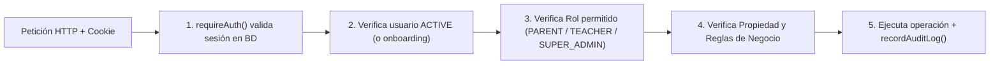

# Fase 3: Seguridad y Privacidad

> **Versión:** 1.4 (Aprobada — Baseline de Seguridad, Validaciones y Ajustes QA Ronda 4)  
> **Estado:** ✅ Cerrada y aprobada  
> **Basado en:** [01-analisis-y-requerimientos.md](./01-analisis-y-requerimientos.md) (`v1.5`) y [02-diseno-y-arquitectura.md](./02-diseno-y-arquitectura.md) (`v1.6`)  
> **Objetivo:** Definir los controles de seguridad, privacidad de menores, protección contra ataques comunes y blindaje del stack (`Next.js + Vercel + Supabase + Resend + Gemini`) manteniendo costo `$0`.

---

## 1. Principios de Seguridad del Proyecto

1. **Cero confianza en el cliente (Backend como única autoridad):** Ni el bloqueo de lecciones futuras, ni los roles, ni la ventana de 3 días de asistencia se validan solo en la UI; todo se aplica estrictamente en los Route Handlers de Next.js.
2. **Privacidad por diseño para menores:** Los datos de los niños (nombres, edad, cuidados/alergias, preferencias, asistencias) nunca son públicos ni indexables, y cada rol solo recibe los campos estrictamente permitidos.
3. **Defensa en profundidad en Supabase:** Aunque toda la app conversa con Supabase desde el backend de Next.js, igualmente activaremos **RLS (Row Level Security)** en todas las tablas sin políticas públicas para evitar cualquier fuga accidental si se expusiera la clave pública (`anon key`).
4. **Mínima superficie y cero secretos en el navegador:** Claves de Supabase (`SERVICE_ROLE_KEY`), Gemini, Resend (`RESEND_API_KEY`), VAPID privada y `CRON_SECRET` viven exclusivamente en variables de entorno de servidor en Vercel.

---

## 2. Matriz de Amenazas y Mitigaciones

| Amenaza | Impacto | Mitigación definida |
| :--- | :--- | :--- |
| **Fuerza bruta sobre códigos OTP (6 dígitos)** | Acceso no autorizado a cuentas de padres, profesores o Super Admin. | Máximo **5 intentos** por código; al 5to fallo el OTP queda invalidado. Expiración de **10 minutos**. Rate limit por RUT y por IP en PostgreSQL. |
| **Enumeración de RUTs / Correos** | Un atacante prueba RUTs para descubrir quién pertenece a la iglesia. | `POST /api/auth/request-otp` responde siempre `200 OK` con mensaje neutro y cooldown en `rate_limits` por `rut_hash`, despachando el correo en `waitUntil` para evitar canales laterales por latencia. |
| **Robo del token de sesión de 30 días (XSS / CSRF)** | Suplantación de identidad durante hasta 30 días. | Token opaco de 32 bytes en cookie **`HttpOnly; Secure; SameSite=Lax`** (`__Host-ed_session` en HTTPS). Validado contra `sessions.token_hash` (SHA-256) en cada petición HTTP; revocable al instante. |
| **IDOR (acceso horizontal entre padres o clases)** | Un padre intenta ver/completar lecciones de otro niño, o un profesor intenta ver otra clase. | Cada endpoint valida relación explícita (`parent_students`, `student_class_history`, `class_teachers`) y que la lección esté desbloqueada para `PARENT`. |
| **Acceso de Padres al PDF original o Ficha interna del niño** | Fuga del material completo del profesor o de datos sensibles/médicos del menor. | Bucket `Private` en Supabase Storage; `GET /api/teacher/units/:id/pdf` verifica `TEACHER` de la clase o `SUPER_ADMIN` y entrega una **Signed Download URL** efímera (60s). Ficha interna omitida en serializaciones de `PARENT`. |
| **Bypass del Cron diario (`/api/cron/daily`)** | Terceros disparando Web Push masivos o saturando la BD. | Validación obligatoria de header `Authorization: Bearer <CRON_SECRET>` usando `crypto.timingSafeEqual`. |
| **Inyección de contenido / XSS desde PDF o Gemini** | Ejecución de scripts en el celular de los padres si un PDF trae contenido malicioso. | La salida de Gemini se valida con esquema **Zod** como texto plano/array de strings; prohibido `dangerouslySetInnerHTML`. |
| **Abuso de cuota gratuita de Correos o Gemini** | Agotamiento del free tier de OTP o IA. | Rate limiting en solicitud de OTP (cooldown 60s, máx. por hora/día) y endpoints `/api/admin/*` restringidos estrictamente a `SUPER_ADMIN`. |

---

## 3. Seguridad en Autenticación (RUT + OTP + Cookie 30 días)

### 3.1. Validación y Normalización del RUT (`@fdograph/rut-utilities`)
- Se utilizará la librería **`@fdograph/rut-utilities`** tanto en **Frontend** (formateo visual `RutFormat.DOTS_DASH`: `12.345.678-5` y feedback inmediato) como en **Backend** (validación autoritativa):
  - Limpieza previa con `cleanRut()` antes de validar longitud mínima/máxima y validación con `validateRut(rut, true)` (Módulo 11 + rechazo automático de patrones sospechosos como `11.111.111-1` o `99.999.999-9`).
  - Normalización canónica en BD en mayúsculas con `formatRut(rut, RutFormat.DASH).toUpperCase()` (sin puntos y con guion, ej. `12345670-K`).
- Si el formato o DV es inválido, el backend rechaza con `400 Bad Request` antes de consultar la BD.

### 3.2. Generación y Verificación Segura del OTP
- **Generación:** `crypto.randomInt(100000, 1000000)` (criptográficamente seguro, nunca `Math.random()`).
- **Almacenamiento:** Nunca guardar el código en texto plano. Se almacena `HMAC-SHA256(rut + ":" + otp, OTP_PEPPER)` en `otp_codes.code_hash`.
- **Ciclo de vida y atomicidad:**
  - Al solicitar un nuevo OTP, se invalidan (`used_at = now()`) códigos previos activos del mismo usuario.
  - Expiración estricta: **10 minutos** (`expires_at`).
  - Límite de intentos fallidos: **5 intentos** por OTP (`attempts >= 5` bloquea el código).
  - Reenvío sin enumeración: cooldown mínimo de **60 segundos** controlado en `rate_limits` por `rut_hash` (sin depender de que el usuario exista en `users`), respondiendo siempre `200 OK` neutro y despachando el envío mediante un helper `runInBackground()` sobre `waitUntil` (con fallback local para `next dev` y captura de errores de Resend en logs de servidor) para evitar diferenciales de tiempo.
  - **Anti *Race Condition*:** Tanto al fallar como al acertar en `POST /api/auth/verify-otp`, la operación SQL exige atómicamente `attempts < 5`:
    - Si coincide: `UPDATE otp_codes SET used_at = now() WHERE id = $1 AND used_at IS NULL AND expires_at > now() AND attempts < 5 RETURNING id` (verificando además dentro de la transacción que `users.status IN ('PENDING_ONBOARDING', 'ACTIVE')`).
    - Si falla: `UPDATE otp_codes SET attempts = attempts + 1 WHERE id = $1 AND used_at IS NULL AND attempts < 5`.
- **Rate Limiting (`$0` usando PostgreSQL):**
  - Tabla ligera `rate_limits` (clave `ip_hash` o `rut_hash`, ventana de tiempo, contador):
    - Cooldown de **60 segundos** por `rut_hash` (sin exponer estado del usuario).
    - Máximo **5 solicitudes de OTP por RUT cada 15 minutos**.
    - Máximo **15 solicitudes de OTP por IP cada 15 minutos**.
    - Máximo **10 verificaciones fallidas de OTP por IP cada 15 minutos**.

### 3.3. Ciclo de Vida del Token de Sesión (30 días)
- **Generación:** `const rawToken = crypto.randomBytes(32).toString('hex')` (256 bits de entropía).
- **Almacenamiento en BD:** Se guarda únicamente `SHA-256(rawToken)` en `sessions.token_hash` con `expires_at = now() + interval '30 days'`.
- **Entrega en Cookie:**
  - En producción HTTPS: `__Host-ed_session` con `HttpOnly; Secure; SameSite=Lax; Path=/; Max-Age=2592000`.
  - En desarrollo local HTTP (`localhost`): nombre `ed_session` sin `Secure` ni prefijo `__Host-` para permitir pruebas locales sin romper el almacenamiento del navegador.
- **Validación en cada petición HTTP:**
  - Helper `requireAuth()`: calcula `SHA-256` de la cookie, busca sesión activa (`revoked_at IS NULL AND expires_at > now()`) unida a `users` (`status IN ('PENDING_ONBOARDING', 'ACTIVE')`).
  - Si el usuario está en `PENDING_ONBOARDING`, solo puede acceder a `/api/auth/me`, `/api/auth/onboarding`, `/api/auth/logout`, `/api/push/subscribe` y sus datos propios de bienvenida (no al resto de la app hasta completar onboarding). El hook cliente de presencia solo inicia `POST /api/presence/ping` cuando `user.status === 'ACTIVE'`, evitando errores `403` durante el wizard.
- **Revocación e invalidación:**
  - `POST /api/auth/logout` marca `revoked_at = now()` en la sesión actual, borra la cookie y desvincula la suscripción Push de ese dispositivo.
  - El Super Admin puede revocar **todas** las sesiones de un usuario (`UPDATE sessions SET revoked_at = now() WHERE user_id = $1`) o desactivar la cuenta (`status = 'INACTIVE'`, invalidando además sus `otp_codes` pendientes).
  - **Cambio de correo electrónico:** Si el Super Admin edita el correo de un usuario, el sistema **revoca automáticamente todas sus sesiones activas**, **invalida los OTP previos pendientes** (`used_at = now()`) y registra `USER_EMAIL_CHANGED` en `audit_logs`.

---

## 4. Control de Acceso (RBAC y Autorización por Propiedad)

### Reglas Obligatorias por Rol en Backend
1. **`PARENT`:**
   - Requiere `users.status = 'ACTIVE'` y **al menos un hijo con `students.status = 'ACTIVE'`** vinculado en `parent_students` (si todos sus hijos pasan a `INACTIVE`, el acceso del apoderado queda bloqueado automáticamente). Cumplido lo anterior, consulta unidades `ACTIVE` de las clases actuales de sus hijos activos y unidades `FINISHED` donde alguno de esos hijos activos haya participado según `student_class_history` (nunca `DRAFT`).
   - En `GET /api/parent/lessons/:id`: valida **`units.status IN ('ACTIVE', 'FINISHED')`** (nunca `DRAFT`), relación válida por clase actual o historial y que la lección esté desbloqueada (`schedule_status = 'FORCE_UNLOCKED' OR (schedule_status = 'SCHEDULED' AND now() >= unlock_at)`, nunca `PAUSED` ni `FORCE_LOCKED`). Si no cumple, responde `403 Forbidden`.
   - Al completar/desmarcar (`POST .../complete` y `POST .../uncomplete`): reutiliza exactamente el mismo guard de autorización de `GET /api/parent/lessons/:id` (**`units.status IN ('ACTIVE', 'FINISHED')`**, relación válida y **lección desbloqueada** —respondiendo `403 Forbidden` si está en `DRAFT`, `PAUSED`, `FORCE_LOCKED` o con `unlock_at` futuro—), además de verificar explícitamente que cada `studentId` enviado en `studentIds[]` esté `ACTIVE`, pertenezca al `parent_id` autenticado en `parent_students` y corresponda a la `class_id` de esa lección.
   - Bloqueo total de endpoints `/api/teacher/*`, `/api/admin/*`, asistencia, ficha interna del niño (`special_care`, `preferences`) y descarga PDF.
2. **`TEACHER`:**
   - Solo accede a `class_id` presentes en `class_teachers` para su `user_id`.
   - En `GET /api/teacher/units`, `GET /api/teacher/units/:id/pdf` y `GET /api/teacher/lessons/:id/tracking`, valida **`units.status IN ('ACTIVE', 'FINISHED')`** (nunca `DRAFT`), pudiendo ver las 14 lecciones sin bloqueo semanal y descargar el PDF únicamente de sus clases asignadas.
   - En `PUT /api/teacher/attendance`: valida que `attendance_date` sea domingo (`<= hoy` en `America/Santiago`) y que cada `student_id` pertenezca a `students.class_id = :classId` **o** tenga vigencia en `student_class_history` para la fecha `attendance_date` (o ya exista en `attendance_records` de ese domingo), evitando bloquear correcciones tras un traslado reciente. Consulta **`MIN(created_at)` en `attendance_records` para esa `(class_id, attendance_date)`**: si ya existe al menos un registro para esa clase y fecha dominical, valida en `America/Santiago` que `hoy_chile <= fecha_primera_creacion_chile + 3 días`; si excede los 3 días desde esa creación inicial, responde `403 Forbidden` (impidiendo también agregar filas tardías de alumnos nuevos). Si ese domingo aún no tiene ningún registro, permite crearlo.
3. **`SUPER_ADMIN`:**
   - Acceso total a `/api/admin/*` y a las funciones de `/api/teacher/*` sin restricción de clase ni límite de 3 días en asistencia.
   - **Regla de seguridad para proteger al Super Admin único:** El propio Super Admin no puede auto-desactivarse ni cambiarse su propio rol a `PARENT` desde la UI para evitar quedar bloqueado sin administrador.

---

## 5. Blindaje de Supabase, Storage PDF y Datos de Menores

1. **Row Level Security (RLS) activado en 100% de las tablas:**
   - Se habilita `ALTER TABLE <tabla> ENABLE ROW LEVEL SECURITY;` en todas las tablas de Supabase sin crear políticas abiertas para el rol `anon`.
   - El backend Next.js se conecta con la cadena de conexión de Postgres / `SUPABASE_SERVICE_ROLE_KEY` solo en servidor. Así, incluso si alguien inspecciona el código cliente, no puede consultar Supabase directamente desde el navegador.
2. **Almacenamiento privado del PDF (respetando tope 4.5 MB de Vercel Hobby):**
   - Bucket `unit-pdfs` configurado como **Private** con **`file_size_limit = 26214400` (`25 MB`)** y **`allowed_mime_types = ['application/pdf']`** a nivel de bucket en Supabase Storage.
   - Subida mediante **Signed Upload URL** (`POST /api/admin/units/upload-url`): el navegador sube el archivo directamente a Supabase Storage bajo ruta UUID no predecible (`units/<classId>/<uuid>.pdf`). Si se reemplaza un borrador `DRAFT`, no se elimina ni sobrescribe el `pdf_storage_key` previo hasta confirmar la nueva carga.
   - Verificación en servidor (`POST /api/admin/units/:id/process-pdf`): consulta primero los metadatos del objeto en Storage para verificar `size <= 25 MB` antes de descargarlo en memoria; luego valida extensión `.pdf` y **magic bytes** `%PDF-` en los primeros bytes (eliminando el objeto inválido y rechazando si falla). Una vez válido, actualiza `pdf_storage_key` en BD y recién entonces elimina el archivo anterior en Storage (y al eliminar un borrador `DRAFT`, limpia su archivo asociado).
   - Descarga (`GET /api/teacher/units/:id/pdf`): después de validar rol `TEACHER` de esa clase (o `SUPER_ADMIN`), `units.status IN ('ACTIVE', 'FINISHED')` y registrar `PDF_DOWNLOAD` en `audit_logs`, genera y entrega una **Signed Download URL** efímera con **`{ download: true }`** (60 segundos) para forzar `Content-Disposition: attachment` y evitar bloqueos en iOS PWA *standalone*.
3. **No indexación y protección de datos infantiles:**
   - `public/robots.txt` con `User-agent: *` y `Disallow: /`.
   - Meta tag / header `X-Robots-Tag: noindex, nofollow` en toda la aplicación.
   - En los correos OTP, **no incluir nombres de niños ni detalles internos**; solo un mensaje neutro con el código de 6 dígitos y su expiración.

---

## 6. Seguridad de PWA, Cabeceras HTTP, Web Push e IA

### 6.1. Cabeceras HTTP de Seguridad y CSP con Nonce (`next.config.ts` y `proxy.ts`)
- `Strict-Transport-Security: max-age=63072000; includeSubDomains` (HTTPS estricto).
- `X-Content-Type-Options: nosniff`.
- `X-Frame-Options: DENY` (evita *clickjacking*).
- `Referrer-Policy: strict-origin-when-cross-origin`.
- `Permissions-Policy: camera=(), microphone=(), geolocation=()` (la app no pide cámara, micrófono ni ubicación).
- `Content-Security-Policy (CSP)`: generada dinámicamente en `proxy.ts` con **nonce por petición** para `script-src 'self' 'nonce-<valor>' 'strict-dynamic'` (sin `'unsafe-inline'`), `style-src 'self' 'unsafe-inline'` (requerido para `next/font` y estilos dinámicos de progreso/UI), `img-src 'self' data: blob:`, `worker-src 'self'` (registro de `/sw.js`), `connect-src 'self'` más el dominio de Storage firmado de Supabase (`upload-url`), y `object-src 'none'`.

### 6.2. Seguridad en Caché del Service Worker (`public/sw.js`)
- **Regla crítica de privacidad y estabilidad Next.js:** El Service Worker **NO debe cachear** respuestas de `/api/*`, payloads de navegación React Server Components (`?_rsc=` o header `RSC: 1`), documentos HTML privados ni URLs firmadas de PDF. Opera exclusivamente con una **lista blanca estricta** de recursos estáticos públicos inmutables de la shell PWA (`/_next/static/*`, `/icons/*`, `/manifest.webmanifest`, pantalla offline genérica), evitando fugas de datos tras cerrar sesión o pantallas desfasadas en App Router.

### 6.3. Seguridad en Procesamiento con IA (Gemini)
- El texto extraído del PDF se envía con instrucciones claras de sistema separando el rol de instrucciones del texto del PDF (prevención básica de *prompt injection*).
- La respuesta JSON de Gemini devuelve `parent_summary` como arreglo de párrafos limpios (sin Markdown crudo `**`), validado estrictamente con **Zod** (longitud máxima de campos, strings limpios) antes de guardarse en PostgreSQL y renderizado en React como texto plano escapado automáticamente (`
`).

### 6.4. Seguridad en Web Push (VAPID) y Cron
- El payload de la notificación Push del lunes dice únicamente: *"Escuela Dominical: Nueva lección disponible para repasar en casa"* (sin incluir nombres de niños ni datos sensibles en la pantalla bloqueada del celular).
- **Anti-SSRF estricto en suscripciones Push (`POST /api/push/subscribe`):** Parsear con `new URL(endpoint)`, exigir `protocol === 'https:'` (sin puerto no estándar ni credenciales) y validar por `hostname` exacto o sufijo permitido de proveedores oficiales (ej. `fcm.googleapis.com`, `web.push.apple.com`, `updates.push.services.mozilla.com`, `*.notify.windows.com`, sin subdominios engañosos), rechazando URLs arbitrarias o IPs privadas.
- El endpoint `GET /api/cron/daily` verifica `Authorization: Bearer ${process.env.CRON_SECRET}` usando comparación de tiempo constante (`crypto.timingSafeEqual`), y aprovecha su ejecución diaria para **limpiar registros expirados** de `otp_codes`, `rate_limits` y `sessions` vencidas (`expires_at < now()` o revocadas antiguas).

### 6.5. Validación de `Origin` (Anti-CSRF) y Manejo Seguro de Errores
- Además de `SameSite=Lax` en la cookie, todo endpoint mutador (`POST`, `PUT`, `PATCH`, `DELETE`, excepto `/api/cron/*`) exige header `Origin` (o `Referer` equivalente en navegadores/clientes compatibles), **rechazando peticiones sin `Origin`/`Referer` válido o con `Origin: null`**, y verifica coincidencia exacta de esquema+host con `APP_URL`, devolviendo `403 Forbidden` ante discrepancias.
- **Errores seguros en producción:** Las respuestas `500` nunca exponen stack traces, consultas SQL ni detalles internos de Postgres/Drizzle al navegador; solo devuelven un mensaje genérico mientras el detalle queda en logs de servidor.

---

## 7. Validación Estricta de Entradas (Frontend + Backend)

Toda entrada del usuario se valida **en dos capas usando los mismos esquemas Zod compartidos** (`src/lib/validators/`):
- **En Frontend:** Validación en tiempo real + atributo `maxLength` en los campos para evitar envío de datos vacíos, inválidos o excesivos y dar mensajes claros en español.
- **En Backend (autoridad real):** Cada Route Handler ejecuta `schema.safeParse(body)` antes de cualquier operación; si falla, responde `400 Bad Request` con detalle seguro del campo.
- **Sanitización general:** Todos los campos de texto aplican `.trim()` automático, colapsan espacios repetidos y rechazan cadenas compuestas solo por espacios en blanco en campos obligatorios (`min >= 1` tras `trim()`). Los campos **opcionales con longitud mínima** (teléfono, parentesco, rango de edad) preprocesan `""` $\rightarrow$ `undefined` antes de validar `.min()`. Además, en PostgreSQL las columnas `VARCHAR(N)` replican los mismos topes máximos.
- **Validación de parámetros de ruta, unicidad, activación y paginación:**
  - Todo `:id` recibido en rutas (`/api/.../[id]`) se valida como **UUID v4 válido** con Zod (`400 Bad Request` si es inválido) antes de consultar PostgreSQL.
  - **RUT y Correo electrónico son únicos por usuario (`UNIQUE`):** Si el Super Admin intenta registrar un RUT o correo duplicado, el backend devuelve `409 Conflict` con un mensaje claro en español.
  - **Compuerta de publicación de Unidad (`DRAFT` $\rightarrow$ `ACTIVE`):** Antes de activar una unidad (`PATCH /api/admin/units/:id`), el backend valida que la clase no tenga otra unidad `ACTIVE`, que `units.pdf_storage_key` sea `NOT NULL` (confirmado en `process-pdf`) y que las **14 lecciones** cumplan título, pasaje, resumen en párrafos, preguntas válidas, `class_sunday_date` y `unlock_at` (`NOT NULL`).
  - Todo listado paginado (ej. `GET /api/admin/audit-logs`) valida `page >= 1` y `limit` con máximo estricto de **50 registros por página**.

### Matriz de Validación y Límites de Caracteres por Campo

| Módulo / Entidad | Campo | Requerido | Mín. | Máx. | Reglas de formato y sanitización |
| :--- | :--- | :---: | :---: | :---: | :--- |
| **Auth** | RUT | Sí | 7 (limpio) | 9 (limpio) / 12 (visual) | `cleanRut()` previo al largo (soporta RUTs reales `< 1.000.000`, ej. `987.654-5` = 7 chars) + `validateRut(rut, true)` (`@fdograph/rut-utilities`). En UI `<input>`, limpiar espacios en `onPaste`/`onChange` antes de recortar o usar `maxLength=20` crudo antes de formatear a `12` chars (`12.345.670-K`), evitando truncar el DV al pegar con espacios; guardado `DASH` en mayúsculas (`8..10` chars, ej. `12345670-K`). |
| | Código OTP | Sí | 6 | 6 | Exactamente 6 dígitos numéricos (`/^\d{6}$/`). |
| **Usuario (Prof / Padre / Admin)** | Nombre completo | Sí | 3 | 80 | Letras Unicode (`\p{L}`, incluye tildes/ñ/diéresis), espacios, guion y apóstrofe (`'`, `’`). Sin números ni emojis. |
| | Correo electrónico | Sí | 5 | 120 | Formato email válido, **único por usuario**, `.trim().toLowerCase()`. |
| | Teléfono | No | 8 | 15 | Preprocesa `"" -> undefined`; solo dígitos y `+` inicial opcional (ej. `+56912345678`). |
| | Parentesco | No | 2 | 30 | Preprocesa `"" -> undefined`; texto limpio (ej. `Mamá`, `Papá`, `Abuela`, `Tutor`). |
| **Clase / Curso** | Nombre de clase | Sí | 2 | 60 | Texto limpio (ej. `Párvulos 3-5 años`). |
| | Rango de edad / descripción | No | 2 | 80 | Preprocesa `"" -> undefined`; texto limpio. |
| **Niño / Alumno** | Nombre completo | Sí | 3 | 80 | Letras Unicode (`\p{L}`), espacios, guion y apóstrofe. Sin números ni emojis. |
| | Fecha de nacimiento | No | — | — | Fecha ISO válida (`YYYY-MM-DD`), no futura y no mayor a 25 años de antigüedad. |
| | Cuidados especiales / alergias | No | — | 300 | Texto plano multilínea sanitizado (sin HTML). |
| | Preferencias (etiquetas) | No | — | 10 ítems | Array de máx. 10 etiquetas de hasta **30 caracteres** c/u (ej. `dibujar`, `pintar`, `cantar`, `escribir`). |
| | Nota de preferencias | No | — | 250 | Texto plano sanitizado. |
| **Unidad** | Título de unidad | Sí | 3 | 100 | Texto limpio (ej. `Unidad 1: Héroes de la Fe`). |
| | Archivo PDF | Sí (al crear) | — | 25 MB | MIME `application/pdf`, firma binaria `%PDF-` validada en servidor tras subida firmada, nombre sanitizado máx. 120 chars. |
| **Lección** | Título | Sí | 3 | 120 | Texto limpio (nullable solo en estado `DRAFT`). |
| | Pasaje bíblico base | Sí | 3 | 80 | Texto limpio (ej. `1 Samuel 17:1-50`; nullable solo en `DRAFT`). |
| | Resumen para padres | Sí | 1 párrafo (50 chars total) | 20 párrafos (2.500 chars total) | Array JSON de `1..20` párrafos (c/u `>= 1` char tras `.trim()`) en texto plano limpio (sin HTML ni Markdown crudo), cuya **suma total** esté entre `50` y `2.500` caracteres (nullable solo en `DRAFT`). |
| | Preguntas de refuerzo | Sí | 2 ítems | 5 ítems | Cada pregunta: mín. **10** / máx. **280 caracteres** (nullable solo en `DRAFT`). |
| | Fecha clase / desbloqueo | Sí | — | — | `class_sunday_date` (domingo ISO `YYYY-MM-DD`) y `unlock_at` (`lunes 00:01 America/Santiago`; nullable solo en `DRAFT`, obligatorio al activar `ACTIVE`). |
| **Asistencia** | Fecha domingo | Sí | — | — | Fecha ISO válida (`YYYY-MM-DD`), validada estrictamente como **domingo** (`day === 0`) y `<= hoy` en `America/Santiago`. |
| | Estado presente | Sí | — | — | Booleano estricto (`true` / `false`). |
| | Observación | No | — | 200 | Texto plano (ej. `"Llegó tarde"`, `"Avisó enfermedad"`). |

---

## 8. Logs de Auditoría Inmutables (`audit_logs`)

- **Catálogo unificado de eventos obligatorios:**
  - Auth: `OTP_REQUESTED`, `OTP_FAILED`, `LOGIN_OTP`, `ONBOARDING_COMPLETED`, `LOGOUT`, `SESSION_REVOKED`.
  - Administración: `CLASS_CREATE`, `CLASS_UPDATE`, `USER_CREATE`, `USER_UPDATE`, `USER_EMAIL_CHANGED`, `USER_DEACTIVATE`, `STUDENT_CREATE`, `STUDENT_UPDATE`, `STUDENT_CLASS_CHANGE`, `STUDENT_DEACTIVATE`, `UNIT_PDF_UPLOAD`, `UNIT_ACTIVATE`, `UNIT_FINISH`, `UNIT_DELETE`, `LESSON_AI_GENERATE`, `LESSON_EDIT`, `UNIT_POSTPONE`, `UNIT_UNPOSTPONE`, `LESSON_STATUS_CHANGE`.
  - Operación Profesor/Padre: `PDF_DOWNLOAD`, `ATTENDANCE_SAVE`, `ATTENDANCE_ADMIN_OVERRIDE`, `LESSON_VIEW`, `LESSON_COMPLETE`, `LESSON_UNCOMPLETE`.
  - **Exclusión explícita:** Los pulsos frecuentes de presencia (`POST /api/presence/ping`) **no** se registran en `audit_logs`.
- **Inmutabilidad:** No existen rutas API para editar o borrar `audit_logs`. En los detalles (`details` JSON) nunca se almacenan códigos OTP, tokens de sesión ni suscripciones VAPID privadas.
- **Acceso:** Exclusivo para `SUPER_ADMIN` (`GET /api/admin/audit-logs`).

---

## 9. Checklist de Validación de Seguridad (Previo a Producción)

- [ ] Todas las tablas en Supabase tienen RLS habilitado y cero acceso anónimo.
- [ ] Ninguna variable secreta (`SERVICE_ROLE_KEY`, `GEMINI_API_KEY`, `RESEND_API_KEY`, `VAPID_PRIVATE_KEY`, `OTP_PEPPER`, `CRON_SECRET`) lleva prefijo `NEXT_PUBLIC_`.
- [ ] Todos los formularios comparten validación Zod en Frontend y Backend respetando obligatoriedad, preprocesado de opcionales vacíos y límites de caracteres.
- [ ] Prueba de penetración básica de roles: un `PARENT` intentando llamar a `/api/teacher/*`, `/api/admin/*`, `/api/teacher/units/:id/pdf` o una lección bloqueada/pausada recibe `403`.
- [ ] Prueba de ventana de asistencia: no acepta fechas futuras ni días lunes–sábado (`400`); tras crear asistencia un día, un `TEACHER` intentando modificarla al 4to día calendario desde su creación recibe `403`, mientras `SUPER_ADMIN` puede editarla generando `ATTENDANCE_ADMIN_OVERRIDE`.
- [ ] Prueba de revocación: al revocar la sesión de un usuario o editar su correo, su siguiente petición con la cookie previa falla con `401` y sus OTP pendientes quedan invalidados.
- [ ] Prueba de `Service Worker` y `CSP`: las cabeceras usan nonce válido sin `'unsafe-inline'` en `script-src` (y `style-src` controlado); tras cerrar sesión, no quedan respuestas de `/api/*`, RSC (`?_rsc=`) ni datos privados en Cache Storage.
- [ ] Prueba de correo `5acym.cl`: registros `SPF`, `DKIM` y `DMARC` validados para evitar suplantación y carpeta de Spam.
